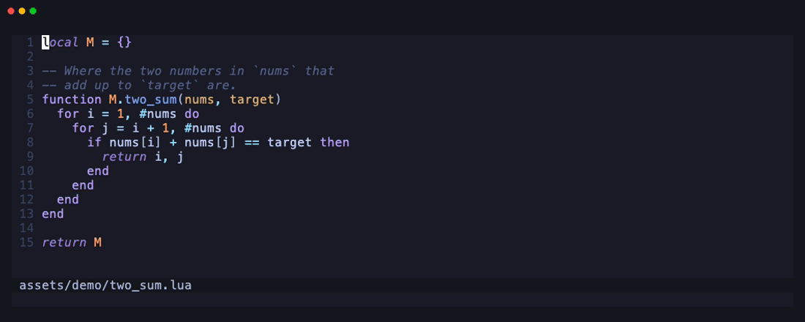
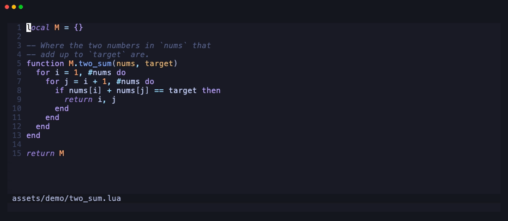
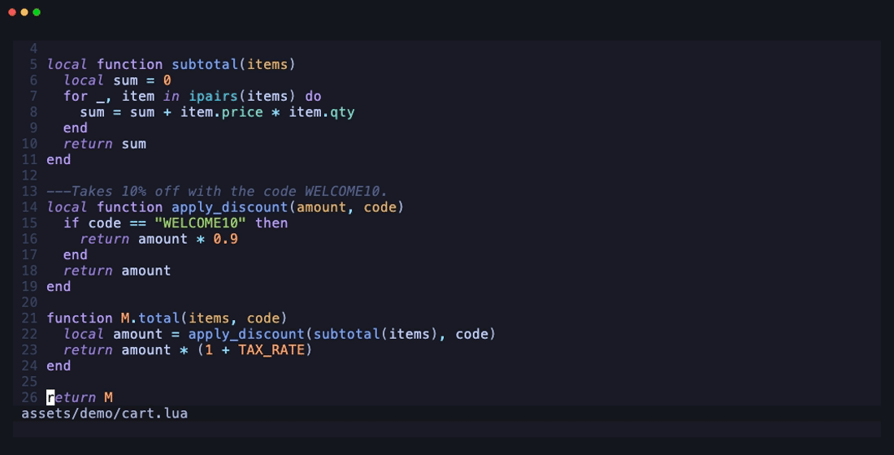
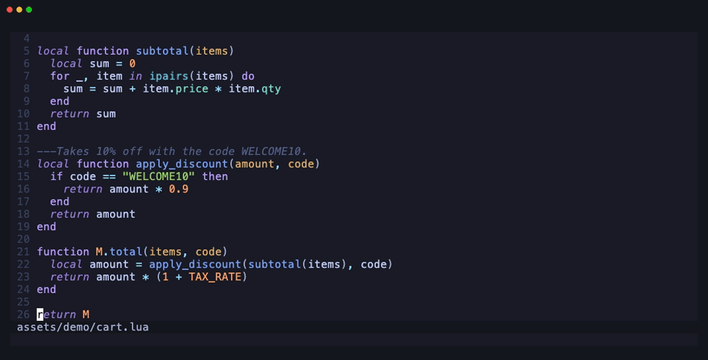
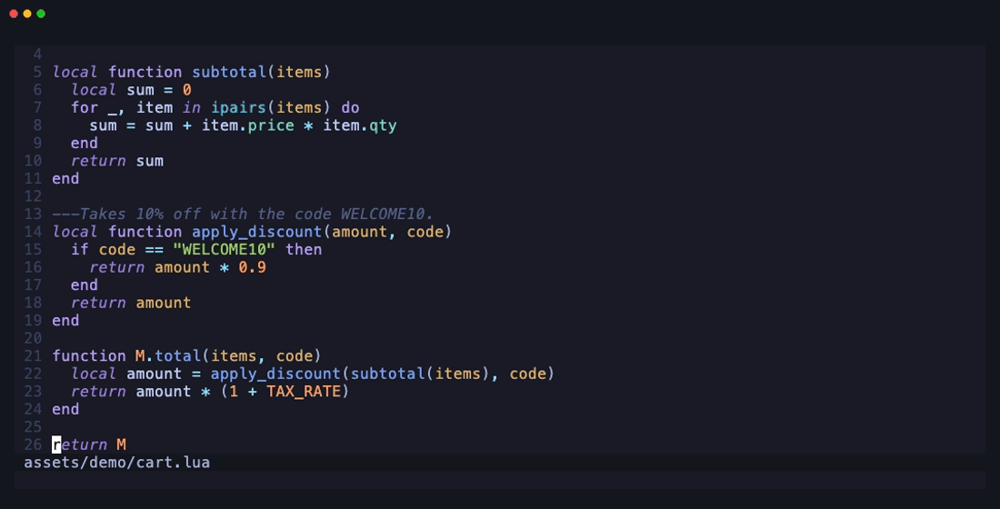

<h1 align="center">float-claude.nvim</h1>

<p align="center"><b>Select code, press a key, ask Claude.</b><br>A tiny popup answers, or rewrites the selection in place, with your Claude Code subscription.</p>

<p align="center">
  <a href="https://github.com/kova1max/float-claude.nvim/actions/workflows/test.yml"></a>
  
  
  <a href="LICENSE"></a>
</p>

<p align="center">ai and asking for one pass: the function is rewritten in place, line by line" width="880"></p>

- **No API key.** It runs the `claude` CLI you are already signed in to, so replies come out of your Claude Code subscription (or whatever the CLI is set up with).
- **A popup at your code, not a chat sidebar.** It opens in the corner with the selection highlighted, and gets out of the way when you want: hide it or step back into the code while Claude keeps working, then come back with the same key.
- **Answers or edits, from one key.** Ask a question and the answer streams in. Ask for a change and the selected lines are rewritten in place (one `u` undoes it), or shown as a diff you accept first.
- **Always on the current code, and it remembers its own changes.** Every follow-up sends the lines as they are now, with diffs of what Claude changed and what you changed since, so "undo your second change" works.
- **Reads like your editor.** Code in answers is highlighted with treesitter, names in it jump to their definitions over LSP, the popup follows your colorscheme (or one of 9 themes), and your own instructions go into every chat.
- **Pure Lua, zero dependencies, light.** `setup()` loads one module and takes 0.74 ms, nothing runs while Claude is not replying, and a streamed answer costs 0.71 ms of CPU per piece, even on a 10,000-line file.

## Requirements

- **Neovim 0.10, 0.11 or 0.12.** CI runs the tests on 0.10.0 and the latest stable release on every change.
- **[Claude Code](https://claude.com/claude-code)**: the `claude` CLI on your `PATH`, signed in (run `claude` once in a terminal).

## Install

With [lazy.nvim](https://github.com/folke/lazy.nvim):

```lua
{
  "kova1max/float-claude.nvim",
  opts = {},
}
```

Any other plugin manager works too: add the repository and call `require("float-claude").setup()`. Then run `:checkhealth float-claude` to see that the CLI is found and no other mapping took the plugin's keys. The full manual is `:help float-claude`.

## Usage

1. Select some lines (`V`), or a block (`<C-v>`).
2. Press `<leader>ai` and type what you want.
3. Press `Enter`.

Claude decides whether your prompt asks for an **answer** or an **edit**:

```
  two_sum.lua · L5–13 · 9 lines
  ❯ what's the time complexity?
    O(n²): the two loops compare every pair in nums.
    Space is O(1).

  ❯ █
```

The header names the file and the lines Claude sees. Past questions are dimmed, replies are indented under them, and a fresh `❯` waits for a follow-up. In Normal mode, `<leader>ai` asks about the current line, or goes back to the open popup.

### Ask



The answer streams in. Names from the code and code blocks are highlighted in the file's language. Keep asking: follow-ups continue the same conversation.

### Edit in place

Ask for a change ("use a table of seen numbers, one pass", the GIF at the top) and the selected lines are rewritten in the buffer, streaming in line by line. The popup stays open with `refactored 9 → 9 lines · u to undo`, so you can keep going ("also rename x"). Each edit is one `u`. Select with `<C-v>` and the edit replaces just the block's columns on each line.

### Review before it lands

yy accepts it" width="880">

With `review_edits = true`, an edit shows as an inline diff (removed lines red, new lines green) and the buffer stays untouched until you decide: `<leader>yy` accepts, `<leader>nn` discards.

### Hide it, keep going

ai brings the popup back with the full answer" width="880">

`<C-q>` hides the popup and `<C-o>` steps back into the code with the popup still on screen. Either way Claude keeps answering or editing. `<leader>ai` brings you back to the same conversation, and `require("float-claude").status()` puts a spinner (then `●` for an unseen reply) in your statusline. Up to 5 chats live side by side, one per selection (`<leader>an` / `<leader>ap` / `<leader>al`), and `<leader>aH` reopens a saved chat, also after restarting Neovim.

### Jump from the answer to the code



With an LSP server attached, the names in an answer that the server knows are underlined. In the conversation (`<C-w>w` from the prompt, or a click), `Enter` or a click jumps to the definition and `K` shows the hover.

### And also

- **One-key actions**: `<leader>ae` explain, `<leader>af` fix the diagnostics, `<leader>at` tests, `<leader>ay` types, `<leader>ad` doc comments, `<leader>as` simplify; for Markdown, commit messages and comments `<leader>ar` reword, `<leader>ah` shorten, `<leader>ag` grammar. Add your own in `actions`.
- **Several ranges at once**: `<leader>am` collects separate selections, then one question (or one edit, one `u`) covers them all.
- **`@` mentions**: `@diagnostics`, `@<buffer>` or `@<path>` sends more context, with completion.
- **Model and effort per chat**: `:FloatClaudeModel sonnet`, `:FloatClaudeEffort high`, shown in the header, switched without restarting the chat.
- **Command palette**: `:FloatClaude` lists everything through `vim.ui.select`, so a picker that replaces it (telescope, fzf-lua, snacks) shows it.
- **Your instructions**: `prompt = "answer in Ukrainian"` (or a function of the filetype), and an opt-in per-project file.
- **Themes**: `theme = "auto"` follows your colorscheme; or `tokyonight`, `catppuccin`, `gruvbox`, `nord`, `onedark`, `rose-pine`, `dracula`, `night-owl`, `float-claude`; `:FloatClaudeTheme` to try them.

Every feature has its section in `:help float-claude` ([doc/float-claude.txt](doc/float-claude.txt)).

## Keys

| Key | Where | Action |
|---|---|---|
| `<leader>ai` | Visual | Ask about the selection (`v`, `V`: lines; `<C-v>`: the block's columns) |
| `<leader>ai` | Normal | Back to the open popup; with none open, ask about the current line |
| `<CR>` | Popup | Send the prompt |
| `<S-CR>` or `<C-j>` | Popup | New line in the prompt (`<C-j>` if your terminal does not send Shift-Enter) |
| `<C-u>` / `<C-d>`, wheel, `<Up>` / `<Down>` | Popup | Scroll the conversation |
| `q` | Popup, Normal mode | Close and end the chat; a half-written edit is undone |
| `<C-q>` | Popup | Hide it; the chat goes on |
| `<C-o>` | Popup | Back to the code; the popup stays on screen |
| `<leader>yy` / `<leader>nn` | Popup, with `review_edits` | Accept / discard the diff |
| `<CR>`, click / `K` | Conversation, on an underlined name | Jump to its definition / show its hover |
| `<leader>ae`, `<leader>af`, ... | Normal, Visual, popup | One-key actions |
| `<leader>am` / `<leader>ax` | Visual, Normal | Add the selection to the ranges to ask about together / clear them |
| `<leader>an` / `<leader>ap`, `<leader>al` | Normal | Next / previous open chat, or pick one |
| `<leader>aH` | Normal | Reopen a saved chat |
| `@` | Popup | Mention a file, a buffer or `@diagnostics` |
| `:FloatClaude` | Normal, Visual | Pick any of the above from a list |

Every key is a setup option, and any of them can be `false`.

## Configuration

Every option, with its default (`opts` for lazy.nvim, or `require("float-claude").setup({...})`). A table option (like `cursor_offset`) is replaced as a whole, so give all of its fields; `actions` is the exception, merged action by action.

```lua
{
  keymap = "<leader>ai", -- Visual + Normal mode: ask about the selection / back to the popup; false to map require("float-claude").ask yourself
  cmd = { "claude" }, -- the CLI, with extra arguments if you like
  model = false, -- each chat's model to start with: "opus", "sonnet", "haiku", "fable" or a model name; false: the CLI's default
  effort = false, -- each chat's effort to start with: "low", "medium", "high", "xhigh" or "max"; false: the CLI's default
  mentions = { max_lines = 500 }, -- @ mentions in the prompt, each sending at most max_lines lines; false: off
  prompt = false, -- your instructions for every chat: a string, or function(ctx) returning one (ctx: buf, file, filetype)
  project_prompt = false, -- e.g. ".float-claude.md": that file, from the file's directory or above, is added
  context_lines = 40, -- unselected lines sent above and below the selection
  diagnostics = true, -- send the diagnostics in the selected lines too
  actions = { -- one-key actions; each is merged on its own, false removes one
    explain = { key = "<leader>ae", prompt = "Explain what this code does." },
    fix = { key = "<leader>af", prompt = "Fix the problems the diagnostics report in this code; with none listed, fix the bugs you find." },
    tests = { key = "<leader>at", prompt = "Write unit tests for this code, in the project's test style, as an answer with a code block; do not edit the code." },
    types = { key = "<leader>ay", prompt = "Add type annotations to this code, in the language's usual way. Change nothing else." },
    docstring = { key = "<leader>ad", prompt = "Add a doc comment to each function in this code, in the language's usual style. Change nothing else." },
    simplify = { key = "<leader>as", prompt = "Simplify this code without changing what it does." },
    reword = { key = "<leader>ar", prompt = "Reword this text so it reads clearly; keep its meaning and tone.", prose = true },
    shorten = { key = "<leader>ah", prompt = "Shorten this text; keep its meaning.", prose = true },
    grammar = { key = "<leader>ag", prompt = "Fix the spelling, grammar and punctuation of this text. Change nothing else.", prose = true },
  },
  prose_filetypes = { "markdown", "gitcommit", "text" }, -- buffers offering the prose actions instead of the code ones
  max_chats = 5, -- chats open at once (one shown, the others hidden); one more ends the one used longest ago
  history = { max = 100, days = 30 }, -- save chats to reopen them; either can be false; false: off
  status = { spinner = { "◐", "◓", "◑", "◒" }, unread = "●" }, -- what status() shows
  width = 50, -- popup width in columns, capped to the screen; longer lines wrap
  max_height = false, -- popup height cap in rows; false: as tall as the screen allows
  placement = "top-right", -- or "cursor": next to the cursor
  top_right_offset = { row = 0, col = 0 }, -- "top-right": rows from the top, columns from the right edge
  cursor_offset = { row = 1, col = 3 }, -- "cursor": rows below, columns right of the cursor (above it when there is no room below)
  theme = "auto", -- or a preset: night-owl, dracula, tokyonight, catppuccin, gruvbox, nord, onedark, rose-pine, float-claude
  colors = {}, -- single colors over the theme, e.g. { bg = "#000000", prompt = "#ff9e64" }
  review_edits = false, -- true: show an edit as a diff and apply it only once accepted
  close_after_edit = false, -- true: close the popup (ending the chat) once an edit is applied
  close_on_leave = false, -- true: leaving the popup (other than with unfocus_key or a jump) closes it
  -- Normal mode keys for the open chats:
  next_chat_key = "<leader>an", -- show the next chat
  prev_chat_key = "<leader>ap", -- show the previous one
  chats_key = "<leader>al", -- pick an open chat from a list
  history_key = "<leader>aH", -- pick a saved chat to reopen
  add_range_key = "<leader>am", -- Visual and Normal mode: add the selection (or the current line) to the ranges to ask about together
  clear_ranges_key = "<leader>ax", -- Normal mode: clear them
  -- Keys in the popup:
  submit_key = "<CR>", -- send the prompt (Insert and Normal mode)
  newline_keys = { "<S-CR>", "<C-j>" }, -- Insert mode: a new line in the prompt
  close_key = "q", -- Normal mode: close the popup and end the chat
  hide_key = "<C-q>", -- hide it; the chat goes on, keymap brings it back
  unfocus_key = "<C-o>", -- back to the code, the popup stays on screen
  accept_key = "<leader>yy", -- with review_edits: accept the diff (Normal mode)
  discard_key = "<leader>nn", -- with review_edits: discard it
  scroll_up_key = "<C-u>", -- scroll the conversation half a screen
  scroll_down_key = "<C-d>",
  line_up_key = "<Up>", -- scroll it a line (in a multi-line prompt, first move between its lines)
  line_down_key = "<Down>",
  jump_key = "<CR>", -- in the conversation, on an underlined name: go to its definition
  hover_key = "K", -- in the conversation, on an underlined name: show its hover
  insert_keys = { "i", "a" }, -- in the conversation: back to the prompt
}
```

For a statusline, `require("float-claude").status()` returns a spinner while a hidden chat answers, `●` for a reply you have not seen, and `""` otherwise. With [lualine](https://github.com/nvim-lualine/lualine.nvim):

```lua
sections = {
  lualine_x = { function() return require("float-claude").status() end, "filetype" },
}
```

## What Claude sees

The file name and filetype, the selected lines, up to 40 lines around them, and the diagnostics in the selected lines, plus whatever you `@`-mention. Every follow-up resends the selected lines as they are at that moment, so Claude always works on the current code, and starts with diffs of what changed since its last reply: its own edits (applied, accepted or discarded) apart from yours.

The CLI runs with no tools, MCP servers, hooks or settings files: Claude reads only what the popup sends and changes only the selected lines, in your buffer, one `u` away. Your `CLAUDE.md` files and `settings.json` are not used; auth comes from your `claude` login or from environment variables such as `ANTHROPIC_API_KEY` in the shell Neovim runs in.

## How it compares

Facts from each project's README (November 2026). Pick by the shape you want: float-claude is for quick questions and edits about the code in front of you; for an agent that runs commands and edits across files, use Claude Code itself (claudecode.nvim puts it in a split), avante.nvim or codecompanion.nvim.

| | float-claude.nvim | [claudecode.nvim](https://github.com/coder/claudecode.nvim) | [avante.nvim](https://github.com/yetone/avante.nvim) | [codecompanion.nvim](https://github.com/olimorris/codecompanion.nvim) | [CopilotChat.nvim](https://github.com/CopilotC-Nvim/CopilotChat.nvim) |
|---|---|---|---|---|---|
| UI | popup at the selection | Claude Code's terminal UI in a split | sidebar | chat buffer, inline | chat window (split or float) |
| Talks to | `claude` CLI, headless | `claude` CLI, over its IDE protocol | API providers (Claude, OpenAI, Gemini, Copilot, ...), ACP agents | HTTP adapters (Anthropic, OpenAI, Copilot, Ollama, ...), ACP agents | GitHub Copilot, plus custom providers |
| Claude subscription without an API key | yes | yes | yes (`auth_type = "max"`, or ACP) | through the Claude Code ACP agent | no (Claude models through Copilot) |
| Edits | in place, streamed, one `u`; optional diff review | diffs to accept or deny | diffs applied to the file | approve or reject agent changes | diffs to accept |
| Dependencies | none | none (snacks.nvim optional) | plenary.nvim, nui.nvim, a `make` build step | plenary.nvim, nvim-treesitter | plenary.nvim, curl, `make tiktoken` |
| Neovim | 0.10+ | 0.8+ | 0.11+ (its badge: 0.12+) | not stated | 0.10+ |

float-claude and claudecode.nvim work side by side; their suggested keys both live under `<leader>a`, so check `:checkhealth float-claude` for clashes.

## FAQ

**Do I need an API key?** No. float-claude starts the `claude` CLI, which uses whatever it is signed in with: a Claude Pro or Max subscription, or an API key, Bedrock or Vertex set up in its environment.

**Does it send my whole file?** No: the selection, up to `context_lines` (40) lines around it, its diagnostics, and what you `@`-mention.

**Can Claude run commands or touch other files?** No. The CLI runs with no tools; a reply is either an answer or the replacement for the selected lines.

**Which model does it use?** The CLI's default, unless you set `model`. `:FloatClaudeModel` and `:FloatClaudeEffort` switch the open chat's.

**Does it work in tmux or over SSH?** Yes, it is all in the terminal. If Shift-Enter does not reach Neovim, `<C-j>` adds a new line.

**Is it slow on big files?** No. Measured on a 10,000-line file with an LSP server attached: 0.71 ms of CPU per streamed piece of an answer and 0.5 ms per piece of an edit; while an answer streams and its names are looked up, the editor is never busy for more than 61 ms at a time. The `claude` process ends when its chat closes or Neovim quits. `tests/bench.lua` measures it on your machine.

## Troubleshooting

- **Updated the plugin and it misbehaves?** Restart Neovim: a running Neovim keeps the old code.
- **Start with `:checkhealth float-claude`.** It checks the Neovim version, that `setup()` ran, that the CLI runs, and which of the plugin's keys another mapping took.
- **"claude exited" or no reply:** run `claude` in a terminal and sign in. Behind a custom install, point `cmd` at it.
- **A key does nothing:** another plugin maps it (`:checkhealth float-claude` names it); change the key in `setup()`.
- **No `@` completion menu on Neovim 0.10:** add `noselect` to `completeopt`, or press `<C-x><C-o>`.
- **Code in answers is not highlighted:** install the treesitter parser for that language (Neovim ships Lua, Vim script, C, Markdown and a few more).
- **Names in answers are not underlined:** they need an LSP server attached to the file.

## Development

Run the tests (headless; a fake CLI stands in for Claude and a fake LSP server for a language server, so no network or account is needed):

```sh
nvim --clean --headless -l tests/run.lua
```

`ONLY=<text>` runs just the tests whose name contains the text.

Measure what the plugin costs (setup time, what runs while idle, CPU per streamed piece of a reply on a 10,000-line file, the longest the editor is blocked, memory), with the same fake CLI and LSP server:

```sh
nvim --clean --headless -l tests/bench.lua
```

The GIFs are recorded with [VHS](https://github.com/charmbracelet/vhs) from the tapes in `assets/`, with the fake CLI scripting Claude's replies: `assets/record.sh` (needs `vhs`, and `lua-language-server` for `lsp.tape`).
